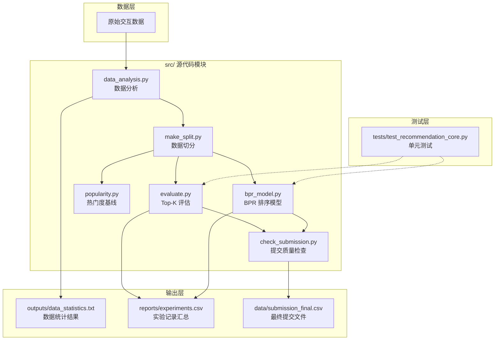

# 成员 A 工作完成情况

**主要职责**：数据分析、数据切分、评估与 BPR 模型  
**核对日期**：2026/11/10

## 1. 成员 A 任务状态

| 任务 | 状态 | 核验情况 |
|---|---|---|
| 数据字段、空值、重复、ID、覆盖率及统计 | 已完成 | 重新运行 `src/data_analysis.py`，结果保存在 `outputs/data_statistics.txt` |
| 固定训练/验证切分 | 已完成 | Seed 42；训练 4,717,042 行、验证 1,152,589 行，覆盖 53,424 位用户 |
| 统一 Top-K 评估器 | 已完成 | micro/macro P/R/F1；会拒绝缺失用户、错误推荐数、重复项及（提供历史时）已读项 |
| 热门度基线 | 已完成 | 使用固定切分重新运行，指标见下表 |
| BPR 排序对照 | 已完成 | 全量固定切分训练并输出验证指标；小型合成数据测试通过 |
| 实验记录与成员 B/C 汇总 | 部分完成 | A 的两项实测结果已写入 `reports/experiments.csv`；当前仓库未见 ItemKNN、ALS/融合结果 |
| 最终提交质量检查 | 检查器已完成，验收待定 | 当前没有 `data/submission_final.csv`，无法执行最终文件检查；须由成员 C 生成 |

## 2. 已复核的数据及基线

本次数据审计确认：

- 训练集 5,869,631 条交互，53,424 位用户，10,000 本图书；重复交互 0 条、空值 0 个。
- 用户交互数中位数 109、范围 17–198；图书交互数中位数 241、最大 22,714；交互密度 1.0987%。
- 测试集 53,424 位用户全部出现在训练集中。
- 提交样例共 534,240 行，所有用户均有 10 行，但全部使用图书 ID 5672，存在 480,816 个用户内重复对；它是占位样例，不可作为预测结果。

固定切分上的热门度 Top-10 结果：

| micro-P@10 | micro-R@10 | micro-F1@10 | macro-P@10 | macro-R@10 | macro-F1@10 |
|---:|---:|---:|---:|---:|---:|
| 0.103435 | 0.047943 | 0.065518 | 0.103435 | 0.048093 | 0.064774 |

同一切分上的 BPR-MF 结果（32 因子、20 轮、学习率 0.05、正则化 0.01、随机种子 42）：

| 模型 | micro-P@10 | micro-R@10 | micro-F1@10 | macro-F1@10 | 图书覆盖率 |
|---|---:|---:|---:|---:|---:|
| 热门度 Top-10 | 0.103435 | 0.047943 | 0.065518 | 0.064774 | 0.0042 |
| BPR-MF | 0.199613 | 0.092523 | 0.126440 | 0.126252 | 0.3946 |

覆盖率为推荐结果中不同图书数 / 训练集图书数。运行时间未测量，不作填写。


## 3. 运行与验证

在项目根目录执行：

```powershell
.\venv\Scripts\python.exe src\data_analysis.py
.\venv\Scripts\python.exe src\make_split.py
.\venv\Scripts\python.exe src\evaluate.py
.\venv\Scripts\python.exe src\popularity.py
.\venv\Scripts\python.exe src\bpr_model.py
.\venv\Scripts\python.exe -m unittest discover -s tests -v
```

提交文件生成后再运行：

```powershell
.\venv\Scripts\python.exe src\check_submission.py data\submission_final.csv
```

`tests/test_recommendation_core.py` 覆盖指标计算、缺失/重复/已读检测及 BPR 小样本排序行为。`src/check_submission.py` 通过退出码报告检查成败；本次没有最终提交文件，因此未声称提交验收通过。

---

## 4. src 项目框架图

### 4.1 目录结构

```text
BookRecommendationSystem/
├── src/
│   ├── data_analysis.py      # 数据分析：字段、空值、重复、ID、覆盖率及统计
│   ├── make_split.py         # 数据切分：固定训练/验证集切分（Seed 42）
│   ├── evaluate.py           # 统一 Top-K 评估器：micro/macro P/R/F1，异常检测
│   ├── popularity.py         # 热门度基线模型
│   ├── bpr_model.py          # BPR 排序模型：训练、预测、验证指标输出
│   └── check_submission.py   # 提交文件质量检查：通过退出码报告成败
├── tests/
│   └── test_recommendation_core.py  # 单元测试：指标计算、缺失/重复/已读检测、BPR 小样本排序
├── data/
│   └── submission_final.csv  # 最终提交文件（由成员 C 生成，当前缺失）
├── outputs/
│   └── data_statistics.txt   # 数据分析结果输出
├── reports/
│   ├── experiments.csv       # 实验记录汇总（成员 A 已写入两项实测结果）
│   ├── BPR_详细介绍.md
│   ├── 评价指标说明.md
│   └── 成员A_工作完成报告.md  # 本文件
└── venv/                     # Python 虚拟环境
```

### 4.2 模块框架图（Mermaid）



### 4.3 各模块功能解释

| 模块文件 | 职责说明 | 成员 A 对应任务 |
|---------|---------|--------------|
| `src/data_analysis.py` | 对原始数据进行字段检查、空值/重复检测、ID 覆盖率统计，输出数据统计报告 | 数据字段、空值、重复、ID、覆盖率及统计分析 |
| `src/make_split.py` | 按固定随机种子（Seed 42）将数据切分为训练集和验证集，保证实验可复现 | 固定训练/验证切分 |
| `src/evaluate.py` | 实现统一 Top-K 评估器，计算 micro/macro P/R/F1；拒绝缺失用户、错误推荐数、重复项及已读项 | 统一 Top-K 评估器构建 |
| `src/popularity.py` | 基于热门度的基线推荐模型，用于与 BPR 模型对比 | 热门度基线运行与指标输出 |
| `src/bpr_model.py` | BPR 矩阵分解排序模型，支持训练、预测、验证指标输出及小样本合成数据测试 | BPR 排序对照实验 |
| `src/check_submission.py` | 对最终提交文件进行格式与内容质量检查，通过退出码报告检查成败 | 最终提交质量检查（依赖成员 C 生成提交文件） |
| `tests/test_recommendation_core.py` | 覆盖指标计算正确性、缺失/重复/已读检测、BPR 小样本排序行为的单元测试 | 测试用例验证 |

### 4.4 模块调用顺序

在项目根目录下，成员 A 完成的验证流程如下：

```powershell
# 1. 数据分析
.\venv\Scripts\python.exe src\data_analysis.py

# 2. 数据切分
.\venv\Scripts\python.exe src\make_split.py

# 3. 统一评估
.\venv\Scripts\python.exe src\evaluate.py

# 4. 热门度基线
.\venv\Scripts\python.exe src\popularity.py

# 5. BPR 模型训练与评估
.\venv\Scripts\python.exe src\bpr_model.py

# 6. 单元测试
.\venv\Scripts\python.exe -m unittest discover -s tests -v
```

提交文件生成后，还需运行：

```powershell
.\venv\Scripts\python.exe src\check_submission.py data\submission_final.csv
```

> **注意**：`src/check_submission.py` 依赖 `data/submission_final.csv`，而该文件当前由成员 C 生成，仓库中尚未出现，因此最终提交验收尚未完成。